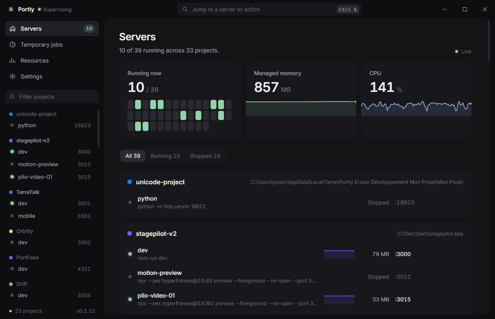

# Portly

**Your dev servers, kept alive. On macOS, Windows and Linux.**

Portly supervises your local development servers. It runs each command in a real terminal, checks its port, restarts it after a crash, and gives you the same controls in a desktop app, a CLI, and a loopback-only HTTP API. Built so your AI coding agents stop launching stray `npm run dev` processes in the background.

[Download](https://github.com/Melvynx/portly/releases/latest) · [portly.melvynx.dev](https://portly.melvynx.dev) · [Windows guide](docs/windows.md)



## What it does

- Projects and servers that stay up: port checks, health URLs, automatic restart after a crash.
- **Temporary** jobs for builds, tests, previews and one-off tasks: they run in the background with a deadline, expose their logs and exit code, and are never restored on the next launch.
- A live **Resources** view: memory and CPU per project, five-minute history, and the heaviest processes running outside Portly.
- An optional memory limit, global or per project, that restarts a server after three over-limit samples in a row.
- An optional inactivity stop (`portly idle-timeout 30m`) for servers that sit quiet.
- **Take over** a server already running outside Portly, including a Docker-published port.
- Start at login with `portly forever enable`.
- An agent skill so Claude Code, Codex and Cursor manage servers through Portly.

## Platforms

| Platform | App | Status |
| --- | --- | --- |
| macOS 14+ | Native SwiftUI menu bar app + CLI | Supported, signed and notarized |
| Windows 10/11 x64 | Native desktop app (Wails) with a notification-area menu + CLI | Supported |
| Linux | Headless supervisor + CLI | Supported |

All three share the same CLI, config format and local API on `127.0.0.1:7737`.

## Install

### macOS

Download `Portly-macOS.zip` from the [latest release](https://github.com/Melvynx/portly/releases/latest), or build from source (Swift 6):

```bash
./build.sh --run
```

This builds and ad-hoc signs `Portly.app`, installs it in `/Applications`, installs `portly` in the first writable bin directory on `PATH`, installs the bundled skill in `~/.agents/skills/portly`, adds idempotent Portly server-management rules to `~/.agents/AGENTS.md`, and launches the app. Reinstalling quits the running app first, which stops every server supervised by Portly. Use `./build.sh --no-install` to assemble `dist/Portly.app` without installing it.

People who download the signed app can complete the same agent setup from the onboarding card at the top of Portly. It installs the bundled skill and CLI, then adds marker-delimited global rules to `~/.agents/AGENTS.md` and `~/.claude/CLAUDE.md` without replacing existing instructions.

To launch Portly at every macOS login, run `./build.sh --forever`, then check it with `portly forever status --json`. `portly forever disable` removes the LaunchAgent and leaves active servers running.

### Windows

Run `PortlySetup.exe` from the Windows release package. It installs the app and the CLI per user under `%LOCALAPPDATA%\Portly`, without administrator rights, adds `portly` to your PATH and creates a Start Menu shortcut.

The app shows projects, temporary jobs, resources, live logs and settings, with a `Ctrl K` command palette. Closing the window hides it and keeps your servers running; **Quit Portly** in the tray menu stops them. Servers run in a ConPTY terminal, through PowerShell (or `cmd.exe` when it is missing), and `portly forever enable` registers a Task Scheduler task at logon.

Build from source (Go 1.22+, Node 22+):

```powershell
cd cli
go build -trimpath -o portly.exe .
cd ..\windows
pnpm --dir frontend install --frozen-lockfile
pnpm --dir frontend build
go run github.com/wailsapp/wails/v2/cmd/wails@v2.10.2 build
```

Details and known limitations: [`docs/windows.md`](docs/windows.md).

### Linux

Linux uses the headless supervisor in [`cli/`](cli). The binary is the supervisor: any CLI command auto-starts a loopback daemon on `127.0.0.1:7737` if needed.

```bash
cd cli
go build -o portly .
sudo install -m 755 portly /usr/local/bin/portly
```

`open` succeeds with a no-UI message, and `forever` manages a systemd user unit; it fails clearly when `systemctl --user` is unavailable. Config and logs stay at `~/.config/portly/`. Docs: [portly.melvynx.dev/linux](https://portly.melvynx.dev/linux)

Do not run the macOS app and a CLI daemon on the same host: both claim `127.0.0.1:7737`.

## FAQ

**Does Portly expose my servers' controls to the network?**
No. The API listens only on `127.0.0.1`, because it can start processes.

**Does it kill processes it doesn't own?**
Never automatically. External processes are only stopped after an explicit confirmation, with a graceful signal first. For Docker-published ports, Portly stops only the container, not Docker itself.

**How does memory differ between platforms?**
macOS reports physical footprint; Windows reports the private working set of each process tree.

## CLI

Every CLI command launches Portly automatically when it is closed. `status` is compact by default: it shows only active servers and problems. Use `--details` for the full human inventory and `--json` for complete machine-readable data.

```bash
portly status
portly status --details
portly status --json

portly memory-limit 5GB
portly memory-limit 3GB --project lumail.io
portly memory-limit inherit --project lumail.io
portly memory-limit off

portly idle-timeout 30m
portly idle-timeout off --server lumail.io/redis
portly idle-timeout inherit --server lumail.io/redis

job_id="$(portly temp 'npm run build' --timeout 20m)"
portly wait "$job_id"

portly temp 'npm run dev -- --host 127.0.0.1 --port 5180' \
  --name transcript-preview \
  --path /path/to/generated/transcript \
  --port 5180 \
  --timeout 1h

portly add-project \
  --name codelynx \
  --path ~/Developer/projects/codelynx.dev-v2 \
  --icon globe \
  --color '#0A84FF' \
  --json

portly add-server \
  --project codelynx \
  --name web \
  --command 'pnpm dev' \
  --port 5173 \
  --start \
  --json

portly logs codelynx/web --tail 100
portly restart codelynx/web --json
portly update-server codelynx/web --action 'clear-cache=trash .next/cache'
job_id="$(portly action codelynx/web clear-cache)"
portly wait "$job_id"
portly take-over codelynx/web --json
portly stop --project codelynx --json
```

Other commands are `temp` (`temporary`, `run-temp`), `wait`, `action`, `memory-limit` (`ram-limit`), `start`, `stop`, `restart`, `take-over` (`adopt`), `update-server`, `remove`, `port`, `kill-port`, `open`, `quit`, `forever`, and `config`. `temp` returns a job ID immediately; `wait` blocks for that ID and exits with the job's real exit code (`124` for timeout). `action` runs a configured maintenance command beside a server without restarting it. `memory-limit` shows or changes the global default and project overrides; it is off by default. `idle-timeout` (`idle`) stops a server that has printed nothing and stayed under 5% CPU for the configured duration; output that only answers Portly's own health checks does not count. It is off by default, servers inherit the global value, and `--server <project/server> off` exempts quiet workloads such as databases. An idle stop is a normal stop, so Portly does not restart the server. `take-over` stops an external listener on the configured port and relaunches the server under Portly. `forever` uses the platform scheduler: LaunchAgent on macOS, systemd --user on Linux, and Windows Task Scheduler on Windows. Run `portly <command> --help` for exact flags. `quit` stops every managed server because the app is the supervisor.

## Configuration

Portly stores its source of truth in `~/.config/portly/config.json` and watches the file for external changes. Server logs live in `~/.config/portly/logs/`.

Temporary jobs are intentionally absent from `config.json`. They exist only in the current Portly app session, appear separately as `temporaryServers` in `portly status --json`, and retain their terminal result for one hour so an agent can wait or inspect logs after a fast command completes.

```json
{
  "version": 1,
  "apiPort": 7737,
  "healthIntervalSeconds": 10,
  "maxRestartAttempts": 5,
  "logBufferLines": 5000,
  "logFileMaxMB": 10,
  "projects": [
    {
      "id": "prj_example",
      "name": "Example",
      "icon": "globe",
      "color": "#0A84FF",
      "root": "/absolute/path/to/project",
      "servers": [
        {
          "id": "srv_example",
          "name": "web",
          "command": "pnpm dev",
          "port": 5173,
          "directory": null,
          "env": {},
          "healthURL": null,
          "healthStatus": null,
          "autoRestart": true,
          "actions": [
            {
              "name": "clear-cache",
              "command": "trash .next/cache"
            }
          ]
        }
      ]
    }
  ]
}
```

`directory` may be absolute or relative to the project root. Portly provides `PORT`, `PORTLY=1`, and `PORTLY_SERVER` to child processes and configured actions. Actions run as supervised temporary jobs in the server's working directory without restarting or stopping the server. A bare port check connects to `localhost` over IPv4 or IPv6; `healthURL` may be a path such as `/api/health` or a complete URL.

## Local API

The control API listens only on `127.0.0.1:7737`. It can start processes, so it is deliberately unavailable to the network.

| Method | Route | Purpose |
| --- | --- | --- |
| `GET` | `/ping` | Version and availability |
| `GET` | `/status` | Projects and live server state |
| `GET` | `/config` | Current configuration |
| `GET` | `/logs?server=web&tail=200` | Recent server output |
| `GET` | `/temporary/status?id=tmp_1234` | Temporary job state, deadline and exit code |
| `GET` | `/ports?port=5173` | Process occupying a port |
| `POST` | `/start`, `/stop`, `/restart` | Act on a server or project |
| `POST` | `/temporary/run` | Start a supervised background job outside any project |
| `POST` | `/actions/run` | Run a configured server action without restarting it |
| `POST` | `/memory-limit` | Configure the global default or a project memory guard |
| `POST` | `/idle-timeout` | Configure the global default or a server inactivity stop (`{"server"?, "seconds"}`; `0` = never, `null` = inherit) |
| `POST` | `/projects/add`, `/projects/remove` | Mutate projects |
| `POST` | `/servers/add`, `/servers/update`, `/servers/remove` | Mutate servers |
| `POST` | `/servers/take-over` | Move an external listener under Portly |
| `POST` | `/ports/kill` | Send SIGTERM to a port occupant |
| `POST` | `/open`, `/quit` | Control the app |

Responses are JSON envelopes with `ok`, `data`, and `error` fields. The CLI is the supported agent-facing interface and handles launching the app and encoding requests.

## Agent skill

The distributable skill is in [`skills/portly`](skills/portly). The installer copies it to the canonical personal root at `~/.agents/skills/portly`, which is shared by Codex and Cursor and exposed to Claude through the standard `~/.claude/skills` compatibility link.

The source installer maintains a marker-delimited rule in `~/.agents/AGENTS.md`. The downloadable app's onboarding also installs it in `~/.claude/CLAUDE.md` so Claude receives the same global fallback. During project setup, the skill requires the same rule in the repository's root `AGENTS.md`; this makes the behavior portable to collaborators and other machines. Every write is idempotent and preserves existing instructions.

## Updates and releases (macOS)

Portly checks the signed Sparkle feed once a day and also exposes **Check for Updates…** in the app menu and Settings. The installed version is visible in Settings and in the standard About window.

To publish a new version, update the single value in `Sources/PortlyCore/Version.swift`, commit and push it, then run:

```bash
./release.sh 0.1.2
```

The release script builds a universal Apple silicon and Intel binary from the pushed commit. It creates a hardened-runtime Developer ID build, submits it to Apple for notarization, staples the ticket, signs the update with the Sparkle key stored in the macOS Keychain, and publishes `Portly-macOS.zip` plus `appcast.xml` to a versioned GitHub release. The landing page and the app feed both follow GitHub's latest release URLs.

